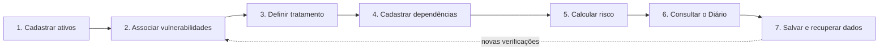
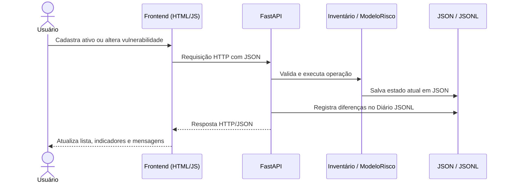
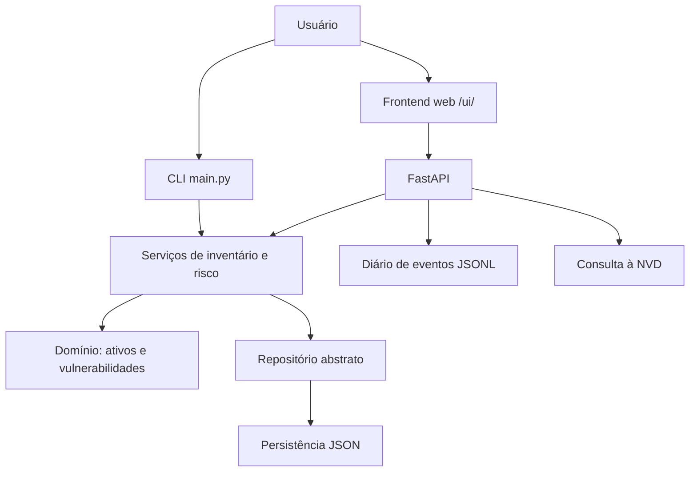

# Cyber Risk Engine — A Vigília

**Inventário de ativos de TI, gestão de vulnerabilidades e análise de risco com álgebra linear.**

Projeto acadêmico desenvolvido em Python no âmbito do **Trabalho 02**, com evolução das Sprints 3 e 4. A aplicação reúne orientação a objetos, persistência JSON, integração com a **National Vulnerability Database (NVD)**, uma API REST construída com **FastAPI**, interface web e execução local em **Docker**.

A interface, chamada **A Vigília**, utiliza uma identidade visual inspirada na atmosfera de *Bloodborne*: os **ativos** são os recursos a proteger, as **vulnerabilidades** representam as “feras” identificadas e o **Diário da Caçada** registra as ações observadas pela API. A linguagem visual é temática; os cálculos e as regras de negócio são implementações técnicas independentes dessa analogia.

> **Estado do projeto — Sprint 4:** integração local de API, frontend e Docker validada; **45 testes automatizados aprovados** em ambiente Python local e no container. A implantação no servidor da faculdade e a comprovação de disponibilidade por 24 horas dependem das orientações da Sprint 5. Este projeto é um protótipo acadêmico, não uma plataforma pronta para produção.

## Sumário

- [Comece por aqui: como funciona o Cyber Risk Engine](#comece-por-aqui-como-funciona-o-cyber-risk-engine)
- [Visão geral e funcionalidades](#visão-geral-e-funcionalidades)
- [Guia de todas as telas da interface](#guia-de-todas-as-telas-da-interface)
- [Tecnologias](#tecnologias)
- [Arquitetura](#arquitetura)
- [Manual da interface CLI](#manual-da-interface-cli)
- [Instalação e execução local](#instalação-e-execução-local)
- [Execução com Docker](#execução-com-docker)
- [Modelo matemático de risco](#modelo-matemático-de-risco)
- [API REST](#api-rest)
- [Persistência e Diário da Caçada](#persistência-e-diário-da-caçada)
- [Testes automatizados](#testes-automatizados)
- [Estrutura do repositório](#estrutura-do-repositório)
- [Diagnóstico e solução de problemas](#diagnóstico-e-solução-de-problemas)
- [Perguntas frequentes](#perguntas-frequentes)
- [Glossário técnico](#glossário-técnico)
- [Limitações e próximos passos](#limitações-e-próximos-passos)
- [Identidade visual e uso de mídia](#identidade-visual-e-uso-de-mídia)

## Comece por aqui: como funciona o Cyber Risk Engine

Este é o ponto de partida recomendado para quem visita o repositório pela primeira vez. **Não é necessário entender Python, FastAPI ou álgebra linear para explorar a interface.** Primeiro, o usuário registra seus recursos de TI; depois, relaciona vulnerabilidades, descreve dependências e solicita o cálculo de risco. O backend executa as regras e devolve o resultado.

### A ideia do programa em uma frase

> **Inventariar o que deve ser protegido, identificar as falhas associadas, descrever como os ativos dependem uns dos outros, calcular a propagação do risco e acompanhar as alterações no Diário da Caçada.**

### O ciclo de funcionamento, do início ao fim



| Etapa | O que a pessoa faz | O que o programa faz |
|---|---|---|
| **1. Inventário** | Cadastra notebook, servidor, roteador ou aplicação web. | Valida os atributos e armazena um objeto do tipo correto. |
| **2. Vulnerabilidades** | Associa falhas aos ativos, manualmente ou a partir de uma pesquisa NVD. | Valida identificadores, descrição, categoria, severidade e estado de tratamento. |
| **3. Tratamento** | Marca uma falha como aberta, em tratamento, corrigida ou aceita. | Persiste o estado; falhas `CORRIGIDA` deixam de contribuir para o risco próprio calculado. |
| **4. Dependências** | Informa qual ativo depende de outro e qual é o nível de dependência. | Constrói vínculos direcionados com pesos definidos pelo modelo. |
| **5. Análise** | Abre **Análise de risco** e clica em **Recalcular**. | Monta matrizes, resolve o sistema linear e devolve as pontuações de risco. |
| **6. Histórico** | Abre **Diário da Caçada** e atualiza a lista. | Consulta eventos observados nas operações da API desde a ativação do diário. |
| **7. Persistência** | Reinicia a API ou recria o container sem apagar o volume. | Lê o inventário JSON e o diário JSONL previamente salvos. |

**Atenção:** o Cyber Risk Engine **não faz varredura automática dos equipamentos**. A associação de uma vulnerabilidade a um ativo depende de uma decisão do usuário. A pesquisa de CVEs na NVD fornece referências públicas; ela não prova que o notebook ou servidor tenha realmente aquela falha.

### Qual interface devo utilizar?

O projeto oferece **duas formas de uso**:

- **Interface gráfica — “A Vigília” (`/ui/`):** indicada para explorar o sistema. Permite CRUD, consulta CVE, dependências, análise de risco, manual **Como funciona** e **Diário da Caçada**.
- **Interface de terminal — `python main.py`:** mantém os menus didáticos originais de ativos, vulnerabilidades e risco. Nem todas as operações extras da API estão expostas como opções diretas da CLI.

As duas reutilizam as classes de domínio e os serviços de negócio, mas **podem ser executadas em processos e arquivos de dados diferentes**. Não use ambas para escrever simultaneamente no mesmo JSON; esta implementação não oferece controle transacional entre processos separados.

### Início rápido: escolha seu ambiente

| Objetivo | Comando principal | Onde abrir | Inventário utilizado |
|---|---|---|---|
| **Experimentar via Docker** | `docker compose up --build -d` | `http://127.0.0.1:8000/ui/` | `/dados/ativos.json` no volume Docker |
| **Experimentar com Python local** | `python -m uvicorn api.app:app --host 127.0.0.1 --port 8001` | `http://127.0.0.1:8001/ui/` | Caminho definido por `CYBER_RISK_DATA` ou `ativos.json` |
| **Usar o terminal** | `python main.py` | O próprio PowerShell | Repositório JSON padrão da CLI |

Se você ainda não configurou Python e Docker, vá às seções [Instalação e execução local](#instalação-e-execução-local) ou [Execução com Docker](#execução-com-docker). Em seguida, volte para o tutorial abaixo.

### Tutorial guiado: primeira caçada completa

Os IDs e nomes seguintes são **somente exemplos didáticos**. Use identificadores ainda não cadastrados na sua instalação e **prefira um inventário de teste**, pois operações como exclusão e mudança de status alteram dados persistentes.

#### Passo 1 — Abrir o inventário

Acesse `http://127.0.0.1:8000/ui/` se estiver utilizando Docker, ou `http://127.0.0.1:8001/ui/` se estiver utilizando Uvicorn local. Na página inicial, você verá o painel **Vigília dos Ativos**, com indicadores de ativos e vulnerabilidades. Um inventário vazio no primeiro uso **é normal**; não significa que a aplicação falhou.

#### Passo 2 — Cadastrar o primeiro ativo

Selecione **Inventário de ativos → + Cadastrar** e use os seguintes valores como referência:

| Campo | Exemplo |
|---|---|
| ID | `9701` |
| Nome | `Notebook Laboratório` |
| Responsável | `Equipe TI` |
| Setor | `Laboratório` |
| Tipo | `Notebook` |
| Processador | `Intel Core i5` |

Ao escolher `Notebook`, a interface solicita o campo específico `processador`. Se você escolher `Servidor`, esse campo é substituído pelo serviço; `Roteador` pede endereço IP; `AplicacaoWeb` pede URL.

**Resultado esperado:** o ativo passa a aparecer na lista. Ao clicar nele, a coluna **Detalhes do ativo** mostra seus atributos, com ações para **Editar**, **Excluir**, **Vulnerabilidades** e **Dependências**.

#### Passo 3 — Cadastrar um segundo ativo

Cadastre outro registro para representar uma dependência técnica:

| Campo | Exemplo |
|---|---|
| ID | `9702` |
| Nome | `Servidor de Serviços` |
| Responsável | `Equipe TI` |
| Setor | `Infraestrutura` |
| Tipo | `Servidor` |
| Serviço | `Serviço de autenticação` |

Agora há dois recursos que podem trocar risco por meio de uma relação direcionada.

#### Passo 4 — Associar uma vulnerabilidade de exemplo

Abra **Vulnerabilidades → + Associar vulnerabilidade**. Selecione o servidor `9702` e preencha:

| Campo | Exemplo |
|---|---|
| ID interno | `9711` |
| Descrição | `Falha de exemplo para demonstração do modelo` |
| Categoria / CWE | `CWE-79` — apenas como categoria ilustrativa |
| Severidade CVSS | `7.1` |
| Tratamento | `ABERTO` |

Os campos CVE, CWE estruturado, versão CVSS e vetor CVSS podem ser preenchidos quando existirem dados confiáveis. **Não invente uma CVE real para um equipamento real** apenas para completar o formulário.

**Resultado esperado:** a vulnerabilidade aparece vinculada ao servidor; sua severidade passa a integrar o cálculo do risco próprio enquanto seu status não for `CORRIGIDA`.

#### Passo 5 — Experimentar a pesquisa NVD (opcional)

Abra **Consulta CVE / NVD**, pesquise `XSS`, `SQL Injection` ou outro termo técnico e analise os resultados retornados pela NVD. Você poderá escolher uma referência para auxiliar a associação a um ativo. A pesquisa depende de internet, da disponibilidade da NVD e da janela temporal configurada no backend. **Não é um scanner de vulnerabilidades nem uma confirmação de exploração.**

#### Passo 6 — Estabelecer uma dependência

Abra **Dependências → + Criar vínculo** e informe:

- **Ativo dependente / destino:** Notebook `9701`.
- **Origem do risco:** Servidor `9702`.
- **Nível:** `MODERADA`.

Essa direção é importante: **o Notebook recebe parte do risco do Servidor**, e não o contrário. No modelo atual, `MODERADA` equivale a peso `0,25`. Assim, o risco efetivo do Notebook poderá aumentar, mesmo que ele não possua vulnerabilidades próprias.

#### Passo 7 — Calcular o risco

Abra **Análise de risco → Recalcular**. O sistema apresenta risco próprio, risco efetivo, comparação visual e número de condição da matriz. Expanda **Inspecionar matrizes M, v, b, A, I − A e x** para visualizar as estruturas matemáticas usadas no cálculo.

**Resultado esperado para o exemplo simplificado:** com apenas o Servidor possuindo severidade `7,1` e o Notebook dependendo dele com peso `0,25`, o risco próprio do Notebook é `0` e o risco efetivo herdado é `1,775` (se não houver outras relações). O resultado é uma **pontuação do modelo**, não um CVSS do notebook.

#### Passo 8 — Registrar a evolução do tratamento

Volte a **Vulnerabilidades**, localize a falha no Servidor e altere seu estado de `ABERTO` para `EM_TRATAMENTO`. Após a validação da correção **em um cenário real**, o operador pode marcar `CORRIGIDA`; neste tutorial, a mudança é apenas uma simulação.

Ao recalcular, a falha corrigida deixa de contribuir para o risco próprio e o risco herdado pode diminuir. Em uma aplicação real, **a marcação de `CORRIGIDA` deve ocorrer somente após verificação técnica independente**.

#### Passo 9 — Consultar o Diário da Caçada

Abra **Diário da Caçada → Atualizar diário**. O sistema lista eventos HTTP observados: cadastro de ativos, associação de vulnerabilidades, alterações de tratamento, alterações de atributos e vínculos, entre outros. O arquivo histórico é separado do inventário.

Os nomes “fera identificada”, “em caçada” e “abatida” fazem parte da metáfora visual. **Não equivalem a uma análise pericial, correção comprovada ou atestado de conformidade**.

#### Passo 10 — Entender persistência e reinicialização

Para testar no Docker, **não use `down -v`**. Recrie o container sem remover o volume:

```powershell
docker compose down
docker compose up -d
docker compose ps
```

Retorne ao inventário e ao diário. Os registros devem reaparecer porque o volume nomeado mantém os arquivos. Essa prova de persistência é **diferente de provar 24 horas ininterruptas de disponibilidade**.

#### Passo 11 — Conferir API e Swagger

Abra `/docs` na mesma porta da aplicação. A documentação interativa mostra as rotas HTTP e permite experimentar consultas, como `GET /ativos` e `GET /risco`. **Evite clicar em “Execute” em rotas de alteração usando o inventário principal**, pois elas persistem dados.

#### Passo 12 — Continuar explorando

Teste busca de ativos, edição de atributos específicos, listagem filtrada de vulnerabilidades, remoção de vínculos e visualização das matrizes. O **Como funciona** dentro da interface oferece explicações resumidas; **este README é o manual de uso e referência técnica aprofundada**.

### Como as partes conversam entre si?



**Resumo prático:** o JavaScript controla a apresentação e envia requisições; ele **não é o responsável pela persistência nem pela resolução das matrizes**. O backend Python aplica as regras de negócio; o inventário é reconstruído na inicialização a partir do JSON configurado; o Diário é lido separadamente do JSONL.

### O que o programa faz — e o que não faz

| Realiza | Não realiza automaticamente |
|---|---|
| Mantém inventário de ativos e vulnerabilidades informadas. | Descoberta de dispositivos na rede ou varredura automática de portas. |
| Consulta referências públicas da NVD por termo. | Confirmação de que uma CVE afeta um equipamento específico. |
| Calcula pontuações próprias e propagadas por dependência. | Estimativa probabilística de incidentes ou prejuízo financeiro. |
| Registra alterações vistas pela API no Diário. | Prova imutável de auditoria, autoria ou remediação. |
| Persiste dados em JSON e volume Docker. | Banco de dados multiusuário com transações distribuídas. |
| Executa localmente em container e responde ao healthcheck. | Comprovação de 24 horas de uptime ou implantação no servidor acadêmico. |

## Visão geral e funcionalidades

O Cyber Risk Engine permite cadastrar ativos de TI, associar vulnerabilidades, definir dependências entre ativos e calcular como a exposição de um componente pode influenciar os demais. O objetivo é transformar um inventário CRUD em um exercício integrado de **engenharia de software e análise de risco**.

| Módulo | Funcionalidades implementadas |
|---|---|
| **Ativos** | Cadastro, listagem, busca, consulta, atualização e exclusão de ativos; validação de campos e atributos específicos por tipo. |
| **Vulnerabilidades** | Associação a ativos, consulta, atualização de descrição/categoria/severidade/tratamento e remoção pela API web. |
| **CVE / NVD** | Pesquisa por termo na API oficial da NVD e obtenção de informações de CVE, CWE e CVSS quando disponíveis. |
| **Dependências** | Cadastro, visualização e remoção de relações que propagam risco entre ativos. |
| **Análise de risco** | Matrizes de incidência e dependência, risco próprio e risco efetivo, com inspeção dos resultados matemáticos. |
| **Diário da Caçada** | Histórico persistente de mudanças observadas em operações HTTP bem-sucedidas, incluindo atualizações de tratamento e atributos. |
| **Como funciona** | Seção explicativa na interface web para orientar a utilização dos módulos. |
| **Interfaces** | Menu interativo no terminal e frontend responsivo em HTML, CSS e JavaScript. |

### Tipos de ativos

Os ativos são modelados por uma classe abstrata `Ativo` e subclasses com atributos próprios:

| Tipo | Classe Python | Atributo específico |
|---|---|---|
| Notebook | `Notebook` | `processador` |
| Servidor | `Servidor` | `servico` |
| Roteador | `Roteador` | `endereco_ip` |
| Aplicação web | `AplicacaoWeb` | `url` |

Cada registro também possui **ID, nome, responsável, setor, vulnerabilidades e dependências**. A aplicação aplica validações de domínio antes de aceitar valores, por exemplo IDs positivos, IP válido para roteadores e URL HTTP(S) válida para aplicações web.

### Tratamento das vulnerabilidades

O enum `Tratamento` utiliza quatro estados:

| Estado | Significado operacional |
|---|---|
| `ABERTO` | Vulnerabilidade registrada e ainda não corrigida. |
| `EM_TRATAMENTO` | Correção ou mitigação em andamento. |
| `CORRIGIDA` | Marcada como corrigida no inventário; desconsiderada no risco próprio do modelo. |
| `ACEITA` | Risco aceito conforme decisão registrada; não equivale a uma correção. |

**Importante:** `CORRIGIDA` indica um **status informado ao sistema**, e não uma comprovação técnica independente de remediação. A classificação CVSS original permanece armazenada mesmo quando a severidade efetiva considerada pelo modelo é zero.

## Guia de todas as telas da interface

A interface **A Vigília** reúne os módulos na barra lateral esquerda. Ao clicar em uma seção, o frontend muda a visualização sem exigir navegação para outro site. As operações que modificam dados são enviadas para a API REST e recebem confirmação ou mensagem de erro.

### 1. Inventário de ativos — Vigília dos Ativos

**Objetivo:** cadastrar e consultar os recursos tecnológicos que serão avaliados. A tela possui quatro indicadores: quantidade de ativos monitorados, vulnerabilidades abertas, em tratamento e corrigidas. Também oferece uma busca por **nome, ID, tipo, setor ou responsável**.

**Operações disponíveis:**

1. **Cadastrar:** clique em `+ Cadastrar`, escolha uma classe de ativo e preencha os campos exigidos.
2. **Consultar:** selecione uma linha da lista para abrir os detalhes completos à direita.
3. **Editar:** use o botão `Editar` do ativo selecionado; o campo específico muda conforme seu tipo.
4. **Excluir:** use `Excluir`, confirme a ação e verifique a remoção da lista e da API.
5. **Navegar para vulnerabilidades:** o botão do ativo selecionado abre a área relacionada às falhas associadas.
6. **Navegar para dependências:** o botão correspondente facilita analisar os vínculos desse ativo.
7. **Sincronizar:** recarrega as informações mais recentes da API para a interface.

A exclusão de um ativo também é tratada pelos serviços de inventário para evitar manter vínculos de dependência apontando para um ativo inexistente. **Como a alteração é persistente, faça backup antes de excluir registros relevantes.**

### 2. Vulnerabilidades — registro e tratamento das falhas

**Objetivo:** manter as falhas que o operador decidiu associar aos ativos. A tela possui filtros por **ativo** e **status de tratamento**, além de formulário para cadastro/edição e ações de remoção.

**Campos essenciais:** ID interno, descrição, categoria, severidade entre 0 e 10 e tratamento. **Campos de referência opcionais no cadastro:** `cve_id`, `cwe_id`, `cvss_vector` e `cvss_version`.

**Fluxo de trabalho:** associe a falha a um ativo → confira sua severidade → altere o tratamento conforme o andamento da remediação → recalcule o risco → verifique o evento no Diário.

Ao editar, a rota HTTP atual aceita **descrição, categoria, severidade e status**; os campos de metadados CVE/CWE/vetor/versão são cadastráveis, mas **não estão expostos como campos editáveis por essa rota**. Portanto, não prometa edição de todos os metadados após o cadastro sem uma implementação adicional.

Quando a mesma CVE é compartilhada por mais de um registro, existem validações de consistência, inclusive de severidade, para não associar pontuações conflitantes à mesma referência.

### 3. Dependências — quem recebe o risco de quem?

**Objetivo:** representar relações de dependência entre ativos, que alteram a propagação de risco no modelo matemático.

O formulário solicita um **ativo destino/dependente**, um **ativo origem** e um **nível**. A interface exibe vínculos, níveis e pesos; permite **criar** e **remover** relações. A configuração atual não possui uma rota dedicada de `PUT`/`PATCH` para editar diretamente uma dependência já existente; pela interface, a alternativa é excluir e cadastrar novamente.

**Exemplo de direção:** se o Notebook A depende do Servidor B, o Notebook A é o destino que recebe risco e o Servidor B é a origem que o transmite. Não confunda a direção com tráfego de rede: trata-se de uma relação de influência **definida pelo modelo**.

**Regra importante:** a classe de domínio impede que a soma dos pesos das dependências de um ativo alcance `1` ou mais, reduzindo o risco de relacionamentos instáveis. Outros cenários também são validados nos serviços.

### 4. Análise de risco — interpretação da tela

Essa tela é uma apresentação dos resultados produzidos por `ModeloRisco`, não um cálculo independente em JavaScript. A tabela contém:

| Coluna | Significado |
|---|---|
| **Ativo** | Identificação do objeto analisado. |
| **Risco próprio** | Soma das severidades não corrigidas associadas ao ativo, segundo `b = Mv`. |
| **Risco efetivo** | Pontuação que incorpora a influência das dependências, obtida por `(I-A)x = b`. |
| **Comparação** | Barra visual para facilitar a comparação entre pontuações. |
| **Número de condição** | Indicador matemático da sensibilidade do sistema linear. |
| **Inspecionar matrizes** | Expõe `M`, `v`, `b`, `A`, `I-A` e `x`. |

O valor **pode ultrapassar 10**. Isso não significa que a fórmula CVSS foi alterada: o programa calcula uma **pontuação agregada acadêmica**, enquanto CVSS descreve severidade de vulnerabilidades individuais.

### 5. Consulta CVE/NVD — dados públicos de vulnerabilidades

**Objetivo:** pesquisar, por palavra-chave, registros publicados na **National Vulnerability Database**.

Digite um termo como `XSS` ou `SQL Injection` e clique em **Pesquisar**. Se houver resultados compatíveis com a consulta e a janela temporal, a interface apresenta identificador CVE, descrição, CWE e pontuação CVSS quando disponível. A opção de associação ajuda a transferir as informações para o cadastro de vulnerabilidade de um ativo escolhido.

**Limitações:** a NVD pode estar indisponível; o programa não pesquisa automaticamente o passado completo, não cruza versões instaladas com versões afetadas e não garante que o ativo esteja vulnerável.

### 6. Como funciona — o Códice do Caçador

Essa é a área de apoio dentro do próprio aplicativo. Ela contém tópicos expansíveis sobre:

1. Inventário e atributos dos ativos.
2. Vulnerabilidades, severidade e tratamento.
3. CVE, CWE, CVSS e NVD.
4. Dependências e direção da propagação.
5. Álgebra linear e risco efetivo.
6. Comunicação frontend/API e persistência.
7. Diário da Caçada e diferença entre histórico e monitoramento Docker.

O Códice é uma **introdução de uso**. O README amplia esses tópicos com comandos, exemplos HTTP, equações, validações e orientações de segurança.

### 7. Diário da Caçada — cronologia das alterações

A página exibe contadores de **registros**, **em caçada** e **abatidas**, filtros por categoria de evento e a lista cronológica dos acontecimentos mais recentes. O botão **Atualizar diário** consulta novamente a API.

- **Registro:** uma alteração observada em operação HTTP bem-sucedida; não é necessariamente um ativo novo.
- **Em caçada:** quantidade de eventos em que uma vulnerabilidade recebeu o estado `EM_TRATAMENTO`.
- **Abatidas:** quantidade de eventos de transição que culminaram em `CORRIGIDA`.

Os indicadores são contagens **de eventos históricos**, não o estoque atual de vulnerabilidades no inventário. O histórico contém data e hora e pode mostrar os campos que mudaram antes/depois, quando detectados. Ele só acompanha operações que passam pela API observada.

### 8. Player de música — recurso opcional e local

O botão **Ativar trilha** controla um elemento `<audio>` do navegador. O arquivo procurado é `frontend/assets/audio/laurence.mp3`, que **não acompanha a distribuição pública nem a imagem Docker**. O navegador pode impedir reprodução automática até ocorrer interação do usuário. Sem o MP3 disponível no caminho esperado, a interface continua utilizável, mas a música não toca.

Para o Docker, copiar o arquivo diretamente para a camada gravável de um container é uma solução **temporária**: ao recriar o container, essa cópia pode desaparecer, mesmo que o volume de dados `/dados` seja preservado. Verifique direitos de uso antes de disponibilizar qualquer gravação.

## Tecnologias

- **Python** — domínio, serviços, persistência, API e interface CLI.
- **NumPy** — criação de matrizes, operações vetoriais e resolução do sistema linear.
- **FastAPI + Pydantic + Uvicorn** — API HTTP, validação de entrada e servidor ASGI.
- **Requests** — consulta à API pública da NVD.
- **HTML, CSS e JavaScript** — interface web, formulários e consumo assíncrono da API.
- **JSON / JSONL** — estado atual do inventário e histórico de eventos.
- **Pytest + HTTPX / TestClient** — testes automatizados do domínio, API e módulos web.
- **Docker e Docker Compose** — execução isolada e persistência em volume nomeado.
- **Git e GitHub** — versionamento e trabalho por branches.

As dependências Python estão relacionadas em [`requirements.txt`](requirements.txt). O Dockerfile da versão validada utiliza `python:3.14-slim`; a execução local requer uma versão de Python compatível com as dependências do projeto.

## Arquitetura

A organização em camadas separa interface, regras de negócio e infraestrutura. As duas interfaces utilizam os mesmos objetos e serviços de domínio, evitando manter dois motores de cálculo diferentes.



**Responsabilidades principais:**

- `dominio/`: entidades, classes abstratas, subclasses, enums e regras de validação.
- `servicos/`: operações do inventário, consulta de vulnerabilidades, ordenação e análise matricial do risco.
- `infraestrutura/`: implementação de repositórios JSON e em memória.
- `api/`: endpoints HTTP, validação dos dados recebidos, integração web e registro de eventos.
- `interface/cli/`: menus e interação via terminal.
- `frontend/`: interface visual, formulários, filtros, consulta NVD e exibição de resultados.
- `tests/`: testes unitários e de integração.

### Programação orientada a objetos e padrões

- **Abstração, herança e polimorfismo:** `Ativo` é a classe base; cada subclasse representa um tipo específico de recurso.
- **Factory:** `FabricaAtivos` centraliza a criação/reconstrução de ativos conforme o tipo.
- **Repository:** `RepositorioAtivos` define a interface de persistência, implementada por `Persistencia` (JSON) e `RepositorioMemoria`.
- **Injeção de dependência:** `Inventario` recebe um repositório, facilitando testes isolados.
- **Strategy:** estratégias de ordenação permitem listar ativos por nome ou risco próprio; também há ordenação usando funções Python.

O padrão Singleton foi estudado, mas não foi adotado para o inventário, a fim de evitar estado global como dependência obrigatória dos serviços.

## Manual da interface CLI

O programa original pode ser executado com `python main.py` na raiz do repositório. `main.py` constrói o repositório JSON, carrega o inventário, instancia o serviço NVD e entrega essas dependências a `MenuPrincipal`.

### Menu principal

```text
===== CYBER RISK ENGINE =====
1 - Gerenciar ativos
2 - Gerenciar vulnerabilidades
3 - Análise de risco
0 - Sair
```

A CLI permanece útil para demonstrações dos conceitos de POO, entrada validada, fluxos condicionais e operações do domínio sem navegador.

### Gerenciar ativos (`interface/cli/menu_ativos.py`)

| Opção | Comportamento |
|---|---|
| `1 - Cadastrar ativo` | Solicita ID positivo, nome, responsável, setor, tipo e atributo específico. |
| `2 - Listar ativos` | Apresenta os recursos cadastrados. |
| `3 - Consultar ativo` | Localiza um ativo por ID e mostra seus atributos. |
| `4 - Atualizar ativo` | Permite atualizar campos comuns e o atributo correspondente à subclasse. |
| `5 - Remover ativo` | Solicita o ID e aplica a remoção via inventário. |
| `0 - Voltar` | Retorna ao menu principal. |

### Gerenciar vulnerabilidades (`interface/cli/menu_vulnerabilidades.py`)

| Opção | Comportamento |
|---|---|
| `1 - Cadastrar vulnerabilidade` | Permite cadastro manual ou pesquisa NVD por termo, depois associação a um ativo. |
| `2 - Listar vulnerabilidades` | Exibe as vulnerabilidades de um ativo informado. |
| `3 - Atualizar vulnerabilidade` | Altera os campos disponíveis, inclusive tratamento. |
| `0 - Voltar` | Retorna ao menu principal. |

A **remoção de vulnerabilidade pela API/web** é uma funcionalidade adicional e não aparece como opção direta nesse menu CLI.

### Análise de risco (`interface/cli/menu_risco.py`)

| Opção | Comportamento |
|---|---|
| `1 - Cadastrar dependência` | Pede ID do ativo destino, ID de origem e nível de dependência. |
| `2 - Listar dependências` | Consulta as dependências de um ativo. |
| `3 - Calcular risco` | Executa as regras do modelo matemático sobre o inventário carregado. |
| `4 - Exibir matrizes` | Mostra as matrizes e vetores utilizados no cálculo. |
| `0 - Voltar` | Retorna ao menu principal. |

A **remoção de dependências** está disponível na API/web, mas não como uma opção direta nesse submenu CLI.

### Validação de entradas no terminal

`MenuBase` reúne funções para ler texto, inteiros positivos, severidades e opções de menu; em situações de entrada inválida, pede novamente apenas o valor necessário. O domínio complementa essas validações para que o comportamento não dependa exclusivamente da interface.

**Atenção ao arquivo de dados:** na implementação da CLI, `Persistencia()` utiliza o caminho padrão `ativos.json`, resolvido em relação ao diretório atual. A variável `CYBER_RISK_DATA` configura a API, não automaticamente a CLI. Execute `python main.py` a partir da raiz do repositório e evite deixar a CLI e a API editando o mesmo arquivo simultaneamente.

### Equivalência entre as interfaces

| Funcionalidade | CLI | Web/API |
|---|---|---|
| Cadastrar, listar, consultar, editar e excluir ativos | Sim | Sim |
| Cadastrar, listar e atualizar vulnerabilidades | Sim | Sim |
| Remover vulnerabilidades | Não há opção direta no menu | Sim |
| Pesquisar NVD e associar referências | Sim | Sim |
| Criar e listar dependências | Sim | Sim |
| Remover dependências | Não há opção direta no menu | Sim |
| Calcular risco e exibir matrizes | Sim | Sim |
| Consultar Diário da Caçada | Não como menu CLI | Sim |
| Abrir o Códice “Como funciona” | Não | Sim |

## Instalação e execução local

### 1. Clonar o repositório

```powershell
git clone https://github.com/KalilCyber/cyber-risk-engine.git
cd cyber-risk-engine
```

### 2. Preparar o ambiente no Windows (PowerShell)

```powershell
python -m venv .venv
.\.venv\Scripts\Activate.ps1
python -m pip install -r requirements.txt
```

Se a política do PowerShell impedir a ativação, você pode autorizar scripts **somente na sessão atual** e tentar novamente:

```powershell
Set-ExecutionPolicy -Scope Process -ExecutionPolicy RemoteSigned
.\.venv\Scripts\Activate.ps1
```

No Linux/macOS, a ativação normalmente é feita com `source .venv/bin/activate`.

### 3. Executar o menu do terminal

```powershell
python main.py
```

O menu inicial apresenta as opções para **gerenciar ativos**, **gerenciar vulnerabilidades** e **analisar risco**. A CLI utiliza o repositório JSON padrão associado ao diretório de execução. Por isso, execute o comando a partir da raiz do projeto e faça backup antes de modificar dados importantes.

### 4. Executar a interface web

Para testar sem modificar o inventário principal, crie uma cópia dos seus dados (caso `ativos.json` já exista):

```powershell
Copy-Item .\ativos.json .\ativos_frontend_teste.json
$env:CYBER_RISK_DATA = Join-Path (Get-Location) 'ativos_frontend_teste.json'
$env:CYBER_RISK_JOURNAL = Join-Path (Get-Location) 'ativos_frontend_teste_diario.jsonl'
python -m uvicorn api.app:app --host 127.0.0.1 --port 8001
```

Se desejar começar com um inventário vazio, crie um arquivo com o conteúdo `[]` e use seu caminho em `CYBER_RISK_DATA`.

Com o servidor iniciado, acesse:

- **Interface gráfica:** <http://127.0.0.1:8001/ui/>
- **Documentação Swagger/OpenAPI:** <http://127.0.0.1:8001/docs>
- **Saúde da API:** <http://127.0.0.1:8001/health>

As variáveis `$env:` valem para a sessão PowerShell atual e os processos iniciados a partir dela. Configure-as **antes** de iniciar o Uvicorn. A configuração `CYBER_RISK_DATA` é utilizada pela **API web**; a CLI, na implementação atual, utiliza sua configuração própria de repositório.

> **Cuidado com dados:** cadastros, edições e exclusões no frontend são gravados no JSON selecionado. Se nenhuma variável `CYBER_RISK_DATA` for informada, a API utiliza o `ativos.json` da raiz como padrão. Para testes destrutivos, prefira sempre uma cópia.

## Execução com Docker

A configuração integrada reúne o backend FastAPI e o frontend no mesmo container. O arquivo [`compose.yaml`](compose.yaml) publica a porta **somente no loopback** do computador anfitrião (`127.0.0.1:8000`) e utiliza um volume Docker nomeado para os dados.

### Pré-requisitos

Docker Desktop com o **Docker Engine em execução** (ou Docker Engine com o plugin Compose em outro sistema).

### Iniciar a aplicação

Na raiz do projeto:

```powershell
docker compose config
docker compose up --build -d
docker compose ps
```

Quando o serviço aparecer como **`Up (healthy)`**, abra:

- **Frontend:** <http://127.0.0.1:8000/ui/>
- **Swagger:** <http://127.0.0.1:8000/docs>
- **API:** <http://127.0.0.1:8000/ativos>

A imagem é construída a partir do arquivo `dockerfile`, declarado explicitamente no Compose.

### Onde ficam os dados?

| Configuração | Caminho no container | Persistência |
|---|---|---|
| `CYBER_RISK_DATA` | `/dados/ativos.json` | Volume `dados_api` |
| `CYBER_RISK_JOURNAL` | `/dados/ativos_diario.jsonl` | Volume `dados_api` |

Em um volume novo, a interface pode começar com **zero ativos**: o `ativos.json` do Windows **não é inserido automaticamente na imagem**, pois o `.dockerignore` o exclui. Os dados do volume são independentes dos arquivos locais e também não são sincronizados por Git.

Para verificar a aplicação e executar testes no container:

```powershell
docker compose exec api python -m pytest -q
docker compose logs --tail=50 api
```

### Parar e preservar a persistência

```powershell
docker compose down
docker compose up -d
```

O volume nomeado permanece disponível após `down` e recriação do container. **Não execute `docker compose down -v` se quiser manter o inventário e o diário**: a opção `-v` remove os volumes associados ao projeto.

**Validação realizada:** o container foi recriado localmente e continuou apresentando um ativo cadastrado na interface e seu respectivo evento no Diário da Caçada. Esse resultado comprova o cenário testado de persistência por volume; não demonstra, por si só, disponibilidade contínua de 24 horas.

### Utilizar um inventário existente (opcional)

Para **um volume novo/vazio**, é possível copiar os registros do Windows para o caminho persistente do container. Faça um backup e confira se o volume ainda não contém dados importantes antes de substituir o arquivo:

```powershell
# Com o container em execução e o volume ainda vazio:
docker cp .\ativos.json cyber-risk-engine-api-1:/dados/ativos.json
docker compose restart api
```

O nome `cyber-risk-engine-api-1` é o nome de container observado na configuração local; confirme o nome em `docker compose ps` caso ele seja diferente. A cópia **não altera o arquivo original no Windows**.

### Trilha sonora local opcional

O player da interface procura `frontend/assets/audio/laurence.mp3`. O arquivo de música **não é distribuído neste repositório nem incorporado à imagem Docker**. Caso o usuário disponha legalmente de um arquivo para uso local, pode disponibilizá-lo em sua própria instalação. Para um teste temporário dentro do container, com o arquivo presente no Windows:

```powershell
docker compose exec api mkdir -p /app/frontend/assets/audio
docker cp .\frontend\assets\audio\laurence.mp3 cyber-risk-engine-api-1:/app/frontend/assets/audio/laurence.mp3
```

A cópia acima fica na camada gravável do container e **pode desaparecer quando ele for recriado**. Não publique o MP3 ou outros materiais de terceiros no Git sem autorização.

## Modelo matemático de risco

O modelo utiliza operações de álgebra linear implementadas em `servicos/modelo_risco.py`.

### 1. Matriz de incidência e severidades

A matriz **`M`** relaciona os ativos (linhas) com as vulnerabilidades únicas (colunas). Uma entrada é `1` quando o ativo possui aquela vulnerabilidade ativa para o modelo e `0` caso contrário. As vulnerabilidades marcadas como `CORRIGIDA` não contribuem para essa matriz.

O vetor **`v`** contém as severidades das vulnerabilidades consideradas no catálogo do modelo. O risco próprio de cada ativo é:

$$
b = Mv
$$

Como o modelo soma contribuições, `b` é uma **pontuação agregada**; não é limitado automaticamente à escala CVSS de 0 a 10.

### 2. Matriz de dependências

A matriz **`A`** descreve a propagação do risco entre ativos. Na linha do ativo que **recebe** risco e na coluna do ativo que **transmite** risco, registra-se o peso da dependência.

Os níveis atualmente definidos no projeto são:

| Nível de dependência | Valor interno | Peso aplicado em `A` |
|---|---:|---:|
| `MUITO_BAIXA` | 0 | 0,00 |
| `BAIXA` | 2 | 0,10 |
| `MODERADA` | 5 | 0,25 |
| `ALTA` | 8 | 0,40 |
| `MUITO_ALTA` | 10 | 0,50 |

O peso é calculado pela regra interna `valor / 20`. **Esses valores são parâmetros adotados neste modelo acadêmico**, não uma tabela oficial de pesos de risco estabelecida pelo NIST.

### 3. Risco efetivo

O risco efetivo `x` considera o risco próprio e aquele propagado pelas dependências:

$$
x = b + Ax
$$

Reorganizando:

$$
(I-A)x = b
$$

Na implementação, `NumPy` resolve o sistema com `numpy.linalg.solve`, sem calcular explicitamente a inversa. O programa verifica se a matriz do sistema é invertível e disponibiliza o **número de condição** como indicador de sensibilidade numérica.

Exemplo conceitual: um notebook com risco próprio `6,4` que herda 25% do risco de um roteador de risco efetivo `0,71` terá:

$$
x_{notebook} = 6,4 + 0,25(0,71) = 6,5775
$$

Esse é um **modelo acadêmico de pontuação e propagação de exposição**. Seu resultado não deve ser interpretado diretamente como probabilidade de incidente, perda financeira esperada ou avaliação completa de risco organizacional. Vulnerabilidades `ACEITA` e `EM_TRATAMENTO` permanecem no cálculo enquanto não estiverem marcadas como `CORRIGIDA`.

### 4. Exemplo matricial completo, com três ativos

Considere três ativos na ordem: **Notebook A**, **Roteador B** e **Servidor C**. Suponha três vulnerabilidades catalogadas: uma no Notebook com severidade `6,4`, uma no Roteador com severidade `8,7` mas marcada como `CORRIGIDA`, e uma no Servidor com severidade `7,1`.

A matriz de incidência `M` e o vetor de severidades `v` podem ser representados por:

$$
M = \begin{bmatrix}
1 & 0 & 0 \\
0 & 0 & 0 \\
0 & 0 & 1
\end{bmatrix}
\quad
v = \begin{bmatrix}6{,}4 \\ 8{,}7 \\ 7{,}1\end{bmatrix}
$$

Observe que a coluna da vulnerabilidade corrigida permanece no catálogo, mas sua linha de incidência é `0` para o ativo corrigido. Assim:

$$
b=Mv=\begin{bmatrix}6{,}4 \\ 0 \\ 7{,}1\end{bmatrix}
$$

Agora considere as seguintes relações: **Notebook A depende do Roteador B com peso 0,25** e **Roteador B depende do Servidor C com peso 0,10**. A matriz de propagação `A`, seguindo a convenção de *linhas = destino* e *colunas = origem*, será:

$$
A = \begin{bmatrix}
0 & 0{,}25 & 0 \\
0 & 0 & 0{,}10 \\
0 & 0 & 0
\end{bmatrix}
$$

O sistema `x = b + Ax` produz as equações:

$$
\begin{aligned}
x_A &= 6{,}4 + 0{,}25x_B \\
x_B &= 0 + 0{,}10x_C \\
x_C &= 7{,}1
\end{aligned}
$$

Resolvendo a partir do Servidor:

$$
x_C=7{,}1, \quad x_B=0{,}71, \quad x_A=6{,}5775
$$

| Ativo | Risco próprio `b` | Risco efetivo `x` | Explicação |
|---|---:|---:|---|
| Notebook A | 6,4 | 6,5775 | Soma o risco próprio e 25% do risco efetivo do roteador. |
| Roteador B | 0,0 | 0,71 | Apesar da vulnerabilidade corrigida, herda 10% do risco efetivo do servidor. |
| Servidor C | 7,1 | 7,1 | Não herda risco no exemplo. |

O resultado mostra a diferença entre **risco próprio** e **risco herdado**: um ativo sem vulnerabilidade ativa pode ainda receber pontuação positiva por causa de uma dependência.

### 5. Métodos matemáticos utilizados no Python

| Método / objeto | Papel |
|---|---|
| `numpy.zeros` | Inicializa matrizes com zeros. |
| `numpy.array` | Constrói os vetores numéricos. |
| `numpy.eye` | Cria a matriz identidade `I`. |
| Operador `@` | Realiza multiplicação matricial `Mv`. |
| `numpy.linalg.matrix_rank` | Verifica se a matriz tem posto completo. |
| `numpy.linalg.cond` | Obtém o número de condição. |
| `numpy.linalg.solve` | Resolve `(I-A)x=b` sem inverter explicitamente a matriz. |

Para um inventário vazio, o modelo devolve um vetor vazio em vez de tentar resolver um sistema sem ativos. Para uma matriz singular, a aplicação rejeita o cálculo e informa que `I-A` não é invertível. Uma matriz mal condicionada pode tornar o resultado sensível a pequenas alterações numéricas; o número de condição ajuda a diagnosticar esse comportamento.

### 6. O que altera o resultado de risco?

- **Adicionar vulnerabilidade ativa:** aumenta o risco próprio do ativo ao qual foi associada, conforme sua severidade.
- **Atualizar severidade:** modifica os valores do vetor `v` e, por consequência, os riscos próprios relacionados.
- **Marcar `CORRIGIDA`:** zera a contribuição da vulnerabilidade na matriz `M`; a severidade CVSS nominal continua armazenada no registro.
- **Marcar `EM_TRATAMENTO` ou `ACEITA`:** não zera automaticamente o risco considerado pelo modelo.
- **Criar dependência:** altera uma entrada da matriz `A` e pode propagar risco a outros ativos.
- **Remover dependência:** interrompe a propagação por aquele vínculo; não corrige vulnerabilidades.
- **Excluir ativo:** altera a quantidade de linhas/colunas do problema e remove referências de dependência ligadas ao ativo eliminado.

### 7. Limites científicos do modelo

O modelo não incorpora diretamente probabilidade de exploração, exposição à internet, existência de controles compensatórios, impacto financeiro, criticidade do processo, valor monetário, frequência de ameaças ou histórico de incidentes. Os níveis de dependência são parâmetros definidos na aplicação. A pontuação calculada **é uma simulação matemática de propagação**, não uma avaliação de risco formal certificada.

## API REST

A API utiliza modelos Pydantic para validar entradas e compartilha os serviços do inventário. Sua documentação interativa é gerada automaticamente pelo FastAPI em `/docs`.

| Método | Endpoint | Função |
|---|---|---|
| `GET` | `/health` | Verifica se o serviço responde. |
| `GET` | `/ativos` | Lista os ativos. |
| `GET` | `/ativos/{id_ativo}` | Consulta um ativo. |
| `POST` | `/ativos` | Cadastra um ativo. |
| `PUT` | `/ativos/{id_ativo}` | Atualiza um ativo. |
| `DELETE` | `/ativos/{id_ativo}` | Remove um ativo. |
| `GET` | `/ativos/{id_ativo}/vulnerabilidades` | Lista vulnerabilidades do ativo. |
| `POST` | `/ativos/{id_ativo}/vulnerabilidades` | Associa uma vulnerabilidade. |
| `PATCH` | `/ativos/{id_ativo}/vulnerabilidades/{id_vuln}` | Atualiza uma vulnerabilidade. |
| `DELETE` | `/ativos/{id_ativo}/vulnerabilidades/{id_vuln}` | Remove a associação da vulnerabilidade. |
| `GET` | `/ativos/{id_ativo}/dependencias` | Lista dependências de um ativo. |
| `POST` | `/ativos/{id_ativo}/dependencias` | Cria uma dependência. |
| `DELETE` | `/ativos/{id_ativo}/dependencias/{origem_id}` | Remove uma dependência. |
| `GET` | `/risco` | Retorna riscos, número de condição e matrizes. |
| `GET` | `/cves?termo=XSS` | Pesquisa vulnerabilidades na NVD. |
| `GET` | `/diario?limite=200` | Consulta o histórico de eventos da API. |
| `GET` | `/ui/` | Abre a interface gráfica. |

### Exemplo de cadastro pela API

Com a API local em `http://127.0.0.1:8001`, no PowerShell:

```powershell
$novoAtivo = @{
    id = 9701
    nome = 'Notebook de Exemplo'
    responsavel = 'Equipe TI'
    setor = 'Laboratório'
    tipo = 'Notebook'
    processador = 'Intel Core i5'
} | ConvertTo-Json

Invoke-RestMethod -Uri 'http://127.0.0.1:8001/ativos' `
    -Method Post `
    -ContentType 'application/json; charset=utf-8' `
    -Body $novoAtivo
```

O `id` deve estar disponível no inventário selecionado. Operações bem-sucedidas criam/alteram registros persistentes; faça esse exemplo somente com dados de teste.

**Respostas relevantes:** `201` para criação, `404` para recursos inexistentes, `409` para alguns conflitos (como ID duplicado) e `422` para validações rejeitadas.

### Consulta CVE, CWE e CVSS

A pesquisa usa a API NVD `https://services.nvd.nist.gov/rest/json/cves/2.0` com filtro por palavras-chave. A implementação atual pesquisa publicações de uma janela recente de **120 dias**, portanto não é uma busca exaustiva por todos os CVEs históricos. Depende de conexão com a internet e da disponibilidade/limites do serviço externo.

- **CVE:** identificador público de uma vulnerabilidade conhecida.
- **CWE:** classificação de tipos de fraqueza de software ou hardware.
- **CVSS:** sistema de pontuação de severidade de vulnerabilidades; **não corresponde, isoladamente, ao risco completo de um ativo**.

### Guia de consumo da API pelo PowerShell

Todos os exemplos abaixo supõem que o servidor local está ouvindo na porta `8001`. **Para Docker, substitua `8001` por `8000`.** Os comandos de escrita modificam o inventário selecionado; execute-os somente em ambiente de teste.

#### Consultar o serviço e os ativos

```powershell
Invoke-RestMethod 'http://127.0.0.1:8001/health'
Invoke-RestMethod 'http://127.0.0.1:8001/ativos'
Invoke-RestMethod 'http://127.0.0.1:8001/ativos/9701'
```

#### Atualizar atributos do ativo

```powershell
$alteracao = @{ nome = 'Notebook Laboratório Atualizado'; processador = 'AMD Ryzen 5' }
# O contrato HTTP usa atributo_especifico para não depender do tipo:
$corpo = @{ nome = $alteracao.nome; atributo_especifico = $alteracao.processador } | ConvertTo-Json
Invoke-RestMethod 'http://127.0.0.1:8001/ativos/9701' -Method Put -ContentType 'application/json' -Body $corpo
```

#### Associar vulnerabilidade

```powershell
$vuln = @{
    id = 9711
    descricao = 'Falha demonstrativa para teste de cadastro'
    categoria = 'CWE-79'
    severidade = 7.1
    status = 'ABERTO'
} | ConvertTo-Json
Invoke-RestMethod 'http://127.0.0.1:8001/ativos/9702/vulnerabilidades' -Method Post -ContentType 'application/json' -Body $vuln
```

#### Alterar o tratamento de uma vulnerabilidade

```powershell
$tratamento = @{ status = 'EM_TRATAMENTO' } | ConvertTo-Json
Invoke-RestMethod 'http://127.0.0.1:8001/ativos/9702/vulnerabilidades/9711' -Method Patch -ContentType 'application/json' -Body $tratamento
```

#### Cadastrar dependência entre ativos

```powershell
$dependencia = @{ origem_id = 9702; nivel = 'MODERADA' } | ConvertTo-Json
Invoke-RestMethod 'http://127.0.0.1:8001/ativos/9701/dependencias' -Method Post -ContentType 'application/json' -Body $dependencia
```

Nesse endpoint, o ID da **URL (`9701`) é o ativo destino** que recebe risco; `origem_id` (`9702`) é a fonte do risco propagado.

#### Consultar análise, NVD e diário

```powershell
$risco = Invoke-RestMethod 'http://127.0.0.1:8001/risco'
$risco.ativos | Select-Object id, nome, risco_proprio, risco_efetivo

Invoke-RestMethod 'http://127.0.0.1:8001/cves?termo=XSS'
Invoke-RestMethod 'http://127.0.0.1:8001/diario?limite=50'
```

#### Remover vínculos ou vulnerabilidades — atenção: ações destrutivas

```powershell
# Exemplo: remove a relação em que o ativo 9701 recebe risco do 9702
Invoke-RestMethod 'http://127.0.0.1:8001/ativos/9701/dependencias/9702' -Method Delete

# Exemplo: remove a vulnerabilidade 9711 do ativo 9702
Invoke-RestMethod 'http://127.0.0.1:8001/ativos/9702/vulnerabilidades/9711' -Method Delete

# Exemplo: remove um ativo de teste
Invoke-RestMethod 'http://127.0.0.1:8001/ativos/9701' -Method Delete
```

### Códigos HTTP e interpretação

| Código | Interpretação prática |
|---|---|
| `200 OK` | Consulta ou atualização concluída normalmente. |
| `201 Created` | Novo recurso cadastrado. |
| `404 Not Found` | Ativo, vulnerabilidade ou vínculo solicitado não existe. |
| `409 Conflict` | Conflito de dados; exemplos incluem ID de ativo já utilizado ou severidade inconsistente com a mesma CVE. |
| `422 Unprocessable Entity` | Dados não passaram pela validação ou regra de negócio aplicável. |
| `500 Internal Server Error` | Falha interna, inclusive problemas de persistência em certas rotas. |
| `502 Bad Gateway` | Falha de consulta ao serviço NVD externo. |

Os corpos de erro do FastAPI frequentemente contêm um campo `detail`. **Não interprete `200` como prova de remediação de uma vulnerabilidade:** ele indica apenas que a operação HTTP correspondente foi concluída.

### Considerações de API

- As rotas `/ativos/{id}` de leitura e `POST /ativos` são definidas em `api/app.py`.
- O CRUD adicional, dependências, risco e NVD são adicionados com `criar_router(...)` em `api/rotas_web.py`.
- O Diário é instalado via `instalar_diario(app, lambda: inventario)`.
- A pasta `frontend/` é servida em `/ui/` via `StaticFiles`.
- A API usa Pydantic para tipos, campos obrigatórios e limites; as entidades do domínio aplicam suas próprias verificações.
- Os endpoints de alteração de `rotas_web.py` utilizam uma rotina de transação em memória que salva o inventário e reverte a lista carregada quando ocorre exceção. Esse mecanismo **não substitui transações entre processos ou um banco de dados ACID**.

## Persistência e Diário da Caçada

### Inventário em JSON

`infraestrutura/persistencia_json.py` serializa objetos para JSON e os reconstrói no carregamento. A gravação utiliza **arquivo temporário e substituição atômica** (`os.replace`), reduzindo a possibilidade de deixar um JSON parcialmente escrito em caso de falha durante a gravação.

A configuração `CYBER_RISK_DATA` permite selecionar o arquivo usado pela **API**; no Docker ele reside no volume `dados_api`.

### Histórico em JSONL

`api/diario_cacada.py` mantém um diário separado, no formato **JSON Lines**: cada linha corresponde a um evento JSON com identificador e data/hora. A variável `CYBER_RISK_JOURNAL` pode definir explicitamente seu caminho.

O middleware observa requisições `POST`, `PUT`, `PATCH` e `DELETE` sob `/ativos`, compara o estado do inventário antes e depois e registra diferenças quando a resposta HTTP indica sucesso. Entre os eventos possíveis estão:

- Cadastro, exclusão e atualização de atributos dos ativos.
- Associação, remoção e alteração de informações de vulnerabilidades.
- Transições de tratamento, como `ABERTO → EM_TRATAMENTO → CORRIGIDA`.
- Criação, remoção e alteração detectável dos campos de dependência.

A rota `GET /diario` aceita `limite` de **1 a 500** eventos, com **200** por padrão. O total registrado e os indicadores de mudança de tratamento são computados a partir do histórico. Esses indicadores representam **eventos registrados**, não necessariamente a quantidade atual de vulnerabilidades por estado.

**Limites do diário:** ele não reconstrói eventos anteriores à ativação, não observa automaticamente ações executadas diretamente pela CLI ou edição manual do JSON e **não é uma trilha de auditoria imutável**. Sua implementação foi concebida para demonstração acadêmica/local e processo único; não fornece, por si só, garantia de auditoria sob alta concorrência ou monitoramento de uptime por 24 horas.

### Diferença entre o arquivo de inventário e o arquivo de histórico

| Característica | Inventário JSON | Diário JSONL |
|---|---|---|
| Pergunta respondida | **O que existe e qual é seu estado atual?** | **O que mudou desde o início do registro?** |
| Forma de gravação | Substitui a representação completa do inventário por gravação atômica. | Acrescenta uma linha JSON para cada evento detectado. |
| Registro de vulnerabilidade corrigida | Armazena o estado final `CORRIGIDA`. | Pode mostrar `ABERTO → EM_TRATAMENTO → CORRIGIDA`, se a mudança ocorreu via API observada. |
| Ao excluir um ativo | O ativo deixa de existir na lista atual. | Eventos históricos já registrados permanecem no arquivo. |
| Origem dos dados | Serviços do inventário e repositório. | Middleware de comparação de estados das operações HTTP. |
| Controle do caminho | `CYBER_RISK_DATA` na API. | `CYBER_RISK_JOURNAL` (ou nome derivado do inventário). |

### Formato de um ativo no arquivo JSON

Exemplo **ilustrativo** do objeto serializado para notebook; identidades e CVEs abaixo são referências fictícias ou genéricas para explicar os campos:

```json
{
  "id": 9701,
  "nome": "Notebook Laboratório",
  "responsavel": "Equipe TI",
  "setor": "Laboratório",
  "tipo": "Notebook",
  "processador": "Intel Core i5",
  "vulnerabilidades": [
    {
      "id": 9711,
      "descricao": "Falha demonstrativa",
      "categoria": "CWE-79",
      "severidade": 7.1,
      "status": "ABERTO",
      "cve_id": null,
      "cwe_id": "CWE-79",
      "cvss_vector": null,
      "cvss_version": null
    }
  ],
  "dependencias": [
    {
      "id_ativo_origem": 9702,
      "nivel": "MODERADA",
      "valor_nist": 5,
      "peso": 0.25
    }
  ]
}
```

O campo `valor_nist` é um **nome interno adotado pelo projeto**. Os valores e a regra de conversão `valor/20` não devem ser interpretados como uma escala de propagação oficialmente prescrita pelo NIST.

### Como o arquivo JSON é gravado

O repositório `Persistencia` converte os objetos usando os métodos de serialização, cria um arquivo temporário no diretório do destino, grava JSON em UTF-8, força a descarga de dados e utiliza `os.replace` para substituir o arquivo anterior. O objetivo é evitar gravações parciais típicas de interrupções durante escrita direta. **Não há, porém, garantia transacional entre o JSON do inventário e o JSONL do Diário.**

Ao carregar o inventário, a infraestrutura reconstrói as subclasses correspondentes ao tipo e valida referências de vulnerabilidade e dependência. Se um JSON for inválido, o programa pode rejeitar o carregamento em vez de aceitar silenciosamente registros inconsistentes.

### Como o Diário detecta uma alteração

1. O navegador envia uma requisição `POST`, `PUT`, `PATCH` ou `DELETE` sob a rota `/ativos`.
2. O middleware do Diário obtém uma fotografia dos campos rastreados **antes** da operação.
3. A API e os serviços tentam realizar a operação e salvar o inventário.
4. Se a resposta HTTP for `2xx`, o middleware obtém a fotografia **depois**.
5. A comparação produz eventos para diferenças observáveis e anexa os registros ao JSONL.
6. Cada evento recebe `evento_id` e `hora` em UTC; a tela formata o horário para exibição.
7. Uma consulta `GET /diario` lê o histórico; por padrão retorna os últimos 200 eventos, do mais recente ao mais antigo, e contagens do total e das transições.

Entre os campos acompanhados estão: nome, responsável, setor e atributo específico do ativo; descrição, categoria, severidade, referências CVE/CWE/CVSS e status da vulnerabilidade; nível e peso da dependência.

**Limitação relevante:** se a gravação do Diário falhar após a alteração do inventário, o código registra a falha no log do servidor; ele não desfaz automaticamente a operação bem-sucedida no inventário. O Diário é um recurso de rastreamento acadêmico, **não um banco de auditoria forte**.

### JSONL, timestamps e contadores

Um evento real contém campos como `evento_id`, `hora`, `tipo`, `ativo_id` e contexto adicional conforme a operação. O campo `alteracoes` pode trazer o valor **anterior** e o **novo** de atributos. A data é gerada em UTC (`datetime.now(timezone.utc)`); o frontend apresenta uma representação local apropriada.

O Diário separa eventos do estado atual. Por exemplo, marcar a mesma vulnerabilidade como `EM_TRATAMENTO`, depois `CORRIGIDA`, produz **duas transições históricas**, embora o inventário tenha somente um estado atual. A leitura do diário conta entradas do tipo `tratamento_atualizado` que terminaram nos estados correspondentes; **não é uma métrica instantânea de quantas vulnerabilidades estão abertas no sistema**.

### O que não entra automaticamente no Diário?

- Cadastros e mudanças anteriores à instalação do middleware.
- Requisições de consulta `GET` sem alteração.
- Operações da CLI executadas independentemente da API web.
- Edição direta dos arquivos JSON/JSONL fora da aplicação.
- Disponibilidade da infraestrutura ao longo do tempo.
- Evidências independentes de que uma vulnerabilidade foi de fato corrigida.

### Ambientes, variáveis de ambiente e proteção dos dados

**Execução local pelo Uvicorn:**

```powershell
# Configure antes de iniciar o servidor e no mesmo terminal
$env:CYBER_RISK_DATA = Join-Path (Get-Location) 'ativos_frontend_teste.json'
$env:CYBER_RISK_JOURNAL = Join-Path (Get-Location) 'ativos_frontend_teste_diario.jsonl'
python -m uvicorn api.app:app --host 127.0.0.1 --port 8001
```

**Execução dentro do Compose:**

```yaml
environment:
  CYBER_RISK_DATA: /dados/ativos.json
  CYBER_RISK_JOURNAL: /dados/ativos_diario.jsonl
volumes:
  - dados_api:/dados
```

O primeiro conjunto cria/usa arquivos no computador anfitrião; o segundo cria/usa arquivos no volume Docker. Arquivos de duas instalações não se tornam iguais apenas porque possuem o mesmo nome. **GitHub e Docker Compose também não sincronizam automaticamente o conteúdo dos volumes.**

### Backup, cópias para teste e recuperação

Antes de testes destrutivos em dados reais, faça cópias **fora do repositório**:

```powershell
$backup = "..\ativos_backup_$(Get-Date -Format 'yyyyMMdd_HHmmss').json"
Copy-Item .\ativos.json $backup
```

Para testar a API com os mesmos dados de referência, mas em um arquivo independente:

```powershell
Copy-Item .\ativos.json .\ativos_frontend_teste.json
$env:CYBER_RISK_DATA = Join-Path (Get-Location) 'ativos_frontend_teste.json'
$env:CYBER_RISK_JOURNAL = Join-Path (Get-Location) 'ativos_frontend_teste_diario.jsonl'
```

**Não execute o Uvicorn antes de configurar as variáveis**. Os arquivos devem estar excluídos do versionamento conforme o `.gitignore`; evite `git add .` sem revisar `git status` e `git diff --cached --stat`.

Para conferir qual inventário a API carregará no modo local:

```powershell
python -c "from api.app import CAMINHO_DADOS; print(CAMINHO_DADOS.resolve())"
```

**Nota:** esse comando importa o módulo da aplicação e, portanto, também inicializa os objetos do backend. Use-o para inspeção, não como substituto de uma validação de consistência dos dados.

## Testes automatizados

A suíte `pytest` verifica cadastro e consulta de ativos, validações, vulnerabilidades, regras de persistência, API web, integração HTTP, diário e operações matriciais do modelo de risco.

Para executar na raiz do repositório:

```powershell
python -m pytest -q
```

Para executar no Docker com o serviço iniciado:

```powershell
docker compose exec api python -m pytest -q
```

**Resultado validado na Sprint 4:** `45 passed, 1 warning` nos testes locais e no container Linux. O aviso observado foi de depreciação da integração entre bibliotecas utilizadas pelo `TestClient`; não ocasionou falhas no resultado reportado.

Os testes de API utilizam inventários isolados/repositórios temporários, evitando modificar o `ativos.json` real durante a execução da suíte. Além dos testes automatizados, foram realizados testes manuais da interface, consulta de risco e persistência de inventário/diário após a recriação do container com o volume preservado.

### Distribuição dos 45 testes pytest

| Arquivo | Quantidade | Foco principal |
|---|---:|---|
| `tests/test_api.py` | 11 | Saúde da API, CRUD HTTP, validação e persistência. |
| `tests/test_inventario.py` | 7 | Cadastro, ID único, atualização atômica e repositório. |
| `tests/test_vulnerabilidades.py` | 7 | Severidade, tratamento, serialização e validação. |
| `tests/test_modelo_risco.py` | 9 | Dimensões, matrizes, dependências, risco, inventário vazio e matriz singular. |
| `tests/test_interface_web.py` | 5 | Rotas adicionais, vulnerabilidades, dependências, risco e NVD. |
| `tests/test_diario_cacada.py` | 6 | Transições, falhas HTTP e detecção de alterações em campos e dependências. |
| **Total** | **45** | **Suíte de regressão automatizada da Sprint 4**. |

### O que foi validado manualmente além dos testes

- Aplicação iniciando no Docker com status **healthy**.
- Frontend acessível em `/ui/` no container.
- Importação de uma cópia dos ativos do Windows para o volume Docker e recuperação na interface.
- Exibição coerente do risco pela interface e por `GET /risco`.
- Associação de vulnerabilidades e alterações de tratamento refletidas no Diário.
- Persistência de um ativo demonstrativo e de um evento de diário após `docker compose down` seguido de `docker compose up -d`, **sem `-v`**.
- Reprodução local da trilha sonora quando o arquivo MP3 foi disponibilizado manualmente no container; esse arquivo **não é incluído no GitHub ou na imagem**.

### Como interpretar os testes

**45 testes aprovados** significa que os cenários implementados na suíte foram executados com sucesso na configuração testada. Isso **não garante ausência de bugs** e não equivale a testes de carga, penetração, segurança de produção ou monitoramento por 24 horas.

O `StarletteDeprecationWarning` observado junto ao `TestClient` indica uma compatibilidade/depreciação de biblioteca; o aviso, por si só, não indica falha funcional, mas recomenda acompanhamento de dependências em futuras atualizações.

### Comandos de desenvolvimento úteis

```powershell
# Testes resumidos
python -m pytest -q

# Relatório individual por teste
python -m pytest -v

# Somente testes da interface web
python -m pytest tests/test_interface_web.py -q

# Somente testes do diário
python -m pytest tests/test_diario_cacada.py -q

# Testes dentro do container em execução
docker compose exec api python -m pytest -q
```

Os testes automatizados usam principalmente instâncias de inventário isoladas e diretórios temporários. Já scripts demonstrativos como `cliente/teste_api.py` **fazem requisições reais à API em execução**, podendo cadastrar dados e falhar por ID duplicado se forem repetidos no mesmo inventário. **Não confunda o script de demonstração com um teste pytest isolado.**

## Estrutura do repositório

```text
cyber-risk-engine/
├── api/
│   ├── app.py                    # Aplicação FastAPI e rotas básicas
│   ├── rotas_web.py              # CRUD web, dependências, risco e NVD
│   └── diario_cacada.py          # Registro e consulta de eventos HTTP
├── cliente/
│   └── teste_api.py              # Cliente HTTP de demonstração
├── dominio/
│   ├── ativos.py                 # Ativo e subclasses
│   ├── vulnerabilidades.py       # Entidade e regras de tratamento
│   ├── enums.py                  # Tratamento e níveis de dependência
│   ├── fabrica_ativos.py         # Factory
│   └── repositorio_ativos.py     # Contrato do Repository
├── servicos/
│   ├── inventario.py             # Operações de inventário
│   ├── modelo_risco.py           # Álgebra linear e propagação do risco
│   ├── servico_cve.py            # Integração com a NVD
│   └── estrategias_ordenacao.py  # Strategy
├── infraestrutura/
│   ├── persistencia_json.py      # Gravação/leitura do inventário
│   └── repositorio_memoria.py    # Repositório em memória
├── interface/
│   └── cli/
│       ├── menu_base.py
│       ├── menu_principal.py
│       ├── menu_ativos.py
│       ├── menu_vulnerabilidades.py
│       └── menu_risco.py
├── frontend/
│   ├── index.html
│   ├── style.css
│   ├── script.js
│   └── assets/
│       └── img/hunters-mark.png
├── tests/                         # Testes pytest e cenários auxiliares
├── docs/                          # Documentação das etapas de desenvolvimento
├── ativos.json                    # Inventário de exemplo/local da CLI
├── main.py                        # Ponto de entrada da CLI
├── requirements.txt
├── dockerfile
├── compose.yaml
├── .dockerignore
└── .gitignore
```

O arquivo de áudio opcional `frontend/assets/audio/laurence.mp3` **não faz parte da distribuição do projeto**. Arquivos de ambiente virtual, caches e diários locais também não devem ser enviados como artefatos da aplicação.

## Diagnóstico e solução de problemas

Este guia reúne problemas encontrados durante o desenvolvimento e falhas típicas de execução local. Execute os comandos na raiz de `cyber-risk-engine` e **não descarte arquivos com `git reset --hard` ou `git clean -fd` sem antes conferir o que será perdido**.

| Sintoma | Causa provável | Como verificar / corrigir |
|---|---|---|
| `ModuleNotFoundError: fastapi` ou `numpy` | Ambiente virtual não ativado ou dependências ausentes. | Ative `.venv` e execute `python -m pip install -r requirements.txt`. |
| `running scripts is disabled` no PowerShell | Política de execução de scripts. | `Set-ExecutionPolicy -Scope Process -ExecutionPolicy RemoteSigned`; depois ative a `.venv`. |
| A interface abre, mas a lista está vazia | Volume Docker recém-criado ou arquivo JSON selecionado sem ativos. | Consulte `GET /ativos` e `CYBER_RISK_DATA`; cadastre um ativo ou copie um inventário para um volume vazio. |
| Os ativos de teste aparecem em `ativos.json` | A API foi iniciada com o arquivo padrão ou em ambiente errado. | Faça backup, confira `CYBER_RISK_DATA` e reinicie o Uvicorn com a variável correta. |
| A porta `8000` ou `8001` está ocupada | Outro servidor/container já está usando a porta. | Verifique processos e `docker compose ps`; escolha uma porta livre para testes locais. |
| `docker compose config` funciona, mas `build` não conecta | Docker Desktop/Engine indisponível. | Abra Docker Desktop; confira `docker info` e `docker version`. |
| `Up (healthy)` não aparece | Startup, dependência ou healthcheck com problema. | `docker compose ps` e `docker compose logs --tail=100 api`. |
| `/ui/` não abre dentro do Docker | Frontend não copiado na imagem ou build antigo. | Verifique `COPY frontend/ ./frontend/` e rode `docker compose up --build -d`. |
| `GET /ativos` devolve `404` | URL incorreta ou ID inexistente. | Confira endereço, porta e ID; `/docs` lista as rotas. |
| Cadastro retorna `409` | Identificador duplicado ou outra inconsistência de dados. | Consulte o ID e escolha outro livre; não sobrescreva automaticamente. |
| Cadastro retorna `422` | Campo ausente, formato inválido ou regra de domínio violada. | Leia `detail` da resposta e corrija apenas o campo indicado. |
| `GET /cves` falha | Internet, janela temporal, limites ou indisponibilidade da NVD. | Verifique a mensagem retornada, conectividade e disponibilidade do serviço; não invente resultados. |
| Risco não muda após marcar `CORRIGIDA` | Dependências ainda podem propagar risco, ou tela não foi recalculada. | Clique em **Recalcular** e confira `risco_proprio` e `risco_efetivo` separadamente. |
| Diário não mostra eventos antigos | Middleware começou a registrar depois daqueles cadastros. | É o comportamento esperado; o Diário não gera passado artificial. |
| Música não toca | MP3 ausente, formato inválido ou bloqueio do navegador. | Confira o caminho `/ui/assets/audio/laurence.mp3` e clique manualmente em **Ativar trilha**. |
| A música some após recriar container | O MP3 foi copiado para a camada do container, não para volume. | Reponha o arquivo localmente; não envie áudio protegido ao GitHub. |
| `Author identity unknown` no Git | Nome/e-mail Git não configurados nessa máquina. | Configure sua identidade Git local/global e repita o commit. |
| Conflito de merge em `api/app.py` | Duas branches alteraram mesma região. | Resolva preservando imports, frontend, diário e `CYBER_RISK_DATA`, execute testes e só depois conclua o merge. |
| Caracteres como `Cibersegurança` no terminal | Problema de codificação na saída do console. | Compare com o JSON UTF-8 e a interface; ajuste a codificação do PowerShell se necessário. |

### Comandos de inspeção sem alterar dados

```powershell
# Git: branch e modificações locais
git status
git branch --show-current

# Docker: estado, logs e configuração
docker compose config
docker compose ps
docker compose logs --tail=100 api

# API: saúde, inventário e histórico
Invoke-RestMethod 'http://127.0.0.1:8000/health'
$ativos = Invoke-RestMethod 'http://127.0.0.1:8000/ativos'
$ativos.Count
$ativos | Select-Object id, nome
Invoke-RestMethod 'http://127.0.0.1:8000/diario?limite=20'
```

### Recuperação do volume Docker: cuidados

- `docker compose down` remove os containers e a rede do projeto, mas **não deve remover o volume nomeado**.
- `docker compose down -v` remove também os volumes do projeto; **não use com dados importantes sem backup**.
- Recriar o container pode apagar arquivos colocados manualmente dentro dele **fora do volume**, como um MP3 copiado para `/app/frontend/assets/audio/`.
- Recriar a imagem com `build` não importa automaticamente o inventário da máquina Windows.
- O caminho `/dados/ativos.json` se refere a um arquivo dentro do volume nomeado, não ao `ativos.json` rastreado pelo Git no host.

## Perguntas frequentes

**O programa descobre vulnerabilidades automaticamente?** Não. O usuário associa vulnerabilidades com base em informações técnicas disponíveis; a NVD oferece referências, não detecção no equipamento.

**O que significa a metáfora da fera?** “Fera” é a identificação temática de uma vulnerabilidade. “Caçada” é o andamento de tratamento. “Abatida” representa `CORRIGIDA` registrado, não uma confirmação de remediação real.

**Posso usar os meus ativos verdadeiros no Docker?** Sim, fazendo uma **cópia** do inventário local para o volume do container. Confirme que o volume não contém dados que seriam sobrescritos e preserve backup do original.

**Por que o Docker começou com zero ativos?** A imagem ignora `ativos.json` do host e usa um volume novo. Isso evita misturar os dados da máquina com os dados de teste do container.

**Por que o risco efetivo pode continuar maior do que zero após uma correção?** A falha corrigida deixa de contribuir para o risco próprio, mas o ativo pode herdar risco de dependências ainda presentes.

**Por que um risco supera 10, se a escala CVSS é de 0 a 10?** O modelo soma severidades e propagação; o resultado efetivo é uma pontuação diferente do CVSS individual.

**O que ocorre se o servidor reiniciar?** Os arquivos persistidos podem ser recarregados do JSON e do JSONL; no Docker, o volume precisa ser mantido. O restart por si só não prova alta disponibilidade.

**Por que aparecem menos eventos no Diário do que ativos?** O inventário representa um estado; o Diário representa eventos observados depois da sua ativação. Os totais têm significados diferentes.

**Os testes modificam meu inventário real?** Os testes automatizados principais trabalham com inventários isolados; scripts manuais que realizam HTTP contra seu servidor podem gravar no inventário selecionado.

**A CLI e o frontend compartilham o mesmo arquivo?** Podem apontar para o mesmo JSON, mas seus processos e configurações diferem; evite gravar simultaneamente sem mecanismo de sincronização entre processos.

**Preciso instalar Docker para usar o projeto?** Não. Também é possível usar Python localmente com Uvicorn e acessar o frontend pelo navegador.

**O player de música faz parte dos requisitos de segurança?** Não. É um recurso de apresentação temática opcional; a aplicação não depende dele para realizar operações.

**O Diário prova execução por 24 horas?** Não. Uma evidência de disponibilidade exige medições periódicas com timestamps e resultados de sucesso/falha, conforme as orientações da Sprint 5.

## Glossário técnico

| Termo | Significado neste projeto |
|---|---|
| **Ativo de TI** | Recurso tecnológico identificado e gerenciado (notebook, servidor, roteador, aplicação web). |
| **Inventário** | Conjunto de ativos, vulnerabilidades e dependências no estado atual. |
| **Vulnerabilidade** | Falha ou fraqueza que pode ser explorada em determinadas condições. |
| **Ameaça** | Agente ou evento com potencial de explorar vulnerabilidades ou causar impacto. |
| **Exposição** | Condições que tornam um ativo alcançável ou suscetível a ataques. |
| **Risco** | Conceito de consequências e incerteza; aqui representado por uma pontuação acadêmica simplificada. |
| **CVE** | Identificador público de uma vulnerabilidade conhecida. |
| **CWE** | Taxonomia de tipos de fraqueza de software/hardware. |
| **CVSS** | Padrão de pontuação de severidade de vulnerabilidades. |
| **NVD** | Base de dados de vulnerabilidades mantida pelo NIST. |
| **CRUD** | Create, Read, Update, Delete: criar, consultar, atualizar, excluir. |
| **POO** | Programação Orientada a Objetos. |
| **Abstração** | Definição das características comuns das entidades em uma classe-base. |
| **Herança** | Especialização da classe `Ativo` em subclasses. |
| **Polimorfismo** | Tratamento de instâncias especializadas por uma interface comum. |
| **Factory** | Padrão para centralizar a criação de objetos. |
| **Repository** | Abstração da origem/destino dos dados persistidos. |
| **Strategy** | Padrão para variar o algoritmo de ordenação. |
| **API REST** | Interface HTTP de acesso a recursos e operações. |
| **FastAPI** | Framework Python usado para definir endpoints e validação. |
| **Pydantic** | Modelagem/validação de dados recebidos pela API. |
| **Uvicorn** | Servidor ASGI usado na execução da API. |
| **Endpoint** | Rota HTTP com um método, por exemplo `GET /ativos`. |
| **Middleware** | Camada que observa/processa requisições e respostas HTTP. |
| **JSON** | Formato textual estruturado usado para armazenar o estado do inventário. |
| **JSONL** | JSON Lines; um objeto JSON por linha, conveniente para eventos. |
| **Persistência atômica** | Técnica de gravar temporariamente e substituir o arquivo de destino. |
| **Container** | Processo isolado executado com filesystem e dependências de uma imagem. |
| **Imagem Docker** | Pacote de filesystem/configuração usado para criar containers. |
| **Volume Docker** | Armazenamento persistente, independente da camada gravável do container. |
| **Healthcheck** | Verificação automática de resposta do serviço, aqui em `/health`. |
| **Matriz `M`** | Matriz de incidência das vulnerabilidades nos ativos. |
| **Vetor `v`** | Severidades das vulnerabilidades catalogadas. |
| **Vetor `b`** | Risco próprio, `b=Mv`. |
| **Matriz `A`** | Pesos direcionais de propagação por dependências. |
| **Vetor `x`** | Risco efetivo, calculado por `(I-A)x=b`. |
| **Número de condição** | Medida da sensibilidade numérica de uma matriz/sistema linear. |
| **Pytest** | Framework usado para automatizar a verificação dos cenários do projeto. |

## Limitações e próximos passos

O projeto foi desenvolvido para **aprendizado, demonstração e avaliação acadêmica**. Alguns limites relevantes da versão atual:

1. **Sem autenticação/autorização de usuários:** não deve ser exposto diretamente à internet ou usado para armazenar informações sigilosas de terceiros.
2. **Persistência em JSON:** adequada aos testes locais; não substitui um banco de dados transacional em ambiente concorrente/multiusuário.
3. **Diário não imutável:** não prova, isoladamente, autoria de ações, remediação efetiva ou disponibilidade contínua.
4. **Modelo de risco simplificado:** pesos e severidades representam uma pontuação acadêmica, não uma análise quantitativa completa de ameaças, probabilidade e impacto de negócio.
5. **NVD:** pesquisa condicionada à janela de 120 dias, rede e disponibilidade da API externa.
6. **Mídia temática:** o áudio não acompanha o repositório/imagem por restrições de distribuição.
7. **Servidor remoto:** implantação na infraestrutura da faculdade e monitoramento durante 24 horas aguardam os requisitos oficiais da Sprint 5.

Evoluções possíveis incluem autenticação, persistência em banco de dados, trilha de auditoria robusta, melhoria de controle de concorrência, ampliação de cobertura de testes e métricas de disponibilidade. Essas melhorias são **possibilidades futuras**, não funcionalidades já entregues.

## Identidade visual e uso de mídia

A identidade **A Vigília / Diário da Caçada** é uma apresentação temática inspirada em *Bloodborne*. *Bloodborne* e seus elementos visuais e sonoros pertencem aos respectivos titulares de direitos; este repositório **não é oficial nem afiliado aos detentores da marca**. Antes de redistribuir ícones, imagens ou outros recursos de terceiros, verifique as permissões de uso correspondentes.

O player da interface suporta música opcional fornecida localmente pelo usuário. O projeto não inclui nem licencia a trilha sonora oficial.

---

**Repositório:** [KalilCyber/cyber-risk-engine](https://github.com/KalilCyber/cyber-risk-engine)

**Propósito:** projeto acadêmico e de portfólio em cibersegurança, programação orientada a objetos, APIs, testes automatizados e containerização.
