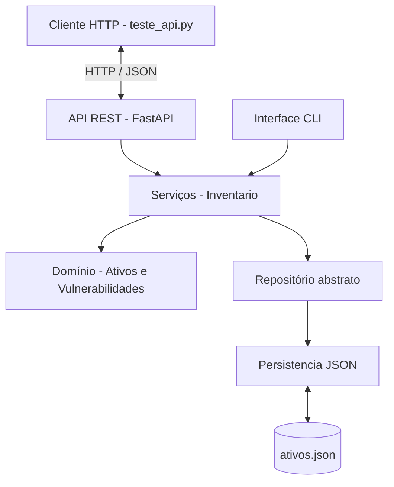

# Arquitetura HTTP — Cyber Risk Engine

## 1. Objetivo

Executar o Trabalho 02 como serviço HTTP contínuo,
reutilizando as classes e regras de negócio existentes.

## 2. Tecnologias utilizadas

- Python
- FastAPI
- Uvicorn
- JSON
- Programação Orientada a Objetos

## 3. Diagrama da arquitetura



## 4. Endpoints implementados

| Método | Rota | Descrição |
|---|---|---|
| GET | /health | Verifica o funcionamento |
| GET | /ativos | Lista os ativos |
| GET | /ativos/{id} | Consulta um ativo |
| POST | /ativos | Cadastra um ativo |

## 5. Execução do servidor

Na raiz do projeto:

```powershell
python -m uvicorn api.app:app --host 127.0.0.1 --port 8000
```

Documentação interativa:

http://127.0.0.1:8000/docs

## 6. Execução do cliente de teste

Com o servidor executando, abrir outro terminal:

```powershell
python cliente/teste_api.py
```

Observação: o cliente cadastra o ativo ID 9001.
Para repetir o teste completo, esse ID precisa
estar disponível.

## 7. Testes realizados

Foram aprovados os seguintes cenários:

1. Verificação de funcionamento do servidor.
2. Listagem dos ativos.
3. Consulta de ativo existente.
4. Consulta de ativo inexistente.
5. Cadastro de ativo por HTTP.
6. Consulta do ativo recém-cadastrado.
7. Rejeição de identificador duplicado.
8. Rejeição de atributo inválido.
9. Recuperação do ativo após reiniciar o servidor.

## 8. Considerações arquiteturais

A API HTTP reutiliza a camada de serviços do projeto.

A interface CLI continua disponível.

A persistência permanece baseada em JSON.

A implementação atual é adequada para execução
local e testes acadêmicos, mas ainda não possui
autenticação, controle de concorrência ou suporte
a múltiplos processos gravando simultaneamente.

Esses aspectos poderão ser aprimorados em
etapas posteriores.
