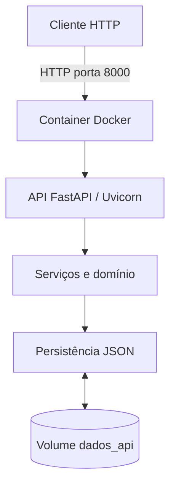

# Containerização com Docker — Cyber Risk Engine

## 1. Objetivo

Executar o Cyber Risk Engine em um container Docker, disponibilizando sua API HTTP de maneira reproduzível e garantindo a persistência dos dados.

A containerização utiliza Docker Desktop, uma imagem Linux com Python 3.14, FastAPI, Uvicorn e Docker Compose.

## 2. Arquivos de configuração

- **Dockerfile:** define a imagem, instala as dependências e inicia o serviço HTTP.
- **.dockerignore:** exclui arquivos temporários, ambientes virtuais e dados locais do contexto de construção.
- **compose.yaml:** define o serviço, a porta, o volume persistente e o healthcheck.
- **api/app.py:** utiliza a variável `CYBER_RISK_DATA` para configurar o caminho do arquivo JSON.

## 3. Arquitetura



O inventário armazenado no volume Docker é separado do arquivo `ativos.json` local.

## 4. Como executar

Na raiz do projeto:

```powershell
docker compose up --build -d
```

Consultar o estado:

```powershell
docker compose ps
```

Ver os logs:

```powershell
docker compose logs --tail=50 api
```

## 5. Endpoints HTTP

- `GET /health` — verifica o funcionamento.
- `GET /ativos` — lista os ativos.
- `GET /ativos/{id_ativo}` — consulta um ativo.
- `POST /ativos` — cadastra um ativo.

Documentação interativa:

http://127.0.0.1:8000/docs

## 6. Testes automatizados

Executar dentro do container:

```powershell
docker compose exec api python -m pytest -q
```

**Resultado obtido:** 34 testes aprovados, com um aviso de compatibilidade de biblioteca sem falhas.

## 7. Validação de persistência

Foi realizado um teste com o ativo:

- ID: 9101
- Nome: Notebook Teste Docker
- Tipo: Notebook

Procedimento:

1. Consultar o ativo pela API.
2. Executar `docker compose down`.
3. Executar `docker compose up -d`.
4. Confirmar que o container está saudável.
5. Consultar novamente o ativo ID 9101.

**Resultado:** o registro permaneceu disponível após a remoção e recriação do container.

Isso confirmou o funcionamento do volume persistente `dados_api`.

## 8. Encerramento do serviço

Para parar e remover o container preservando o volume:

```powershell
docker compose down
```

Atenção: `docker compose down -v` também remove os volumes gerenciados pelo Compose e pode excluir os dados armazenados.

## 9. Conclusão

O Cyber Risk Engine foi executado com sucesso em um ambiente Linux containerizado. A API HTTP permaneceu funcional, os testes automatizados foram aprovados e a persistência JSON foi preservada durante a recriação do container.